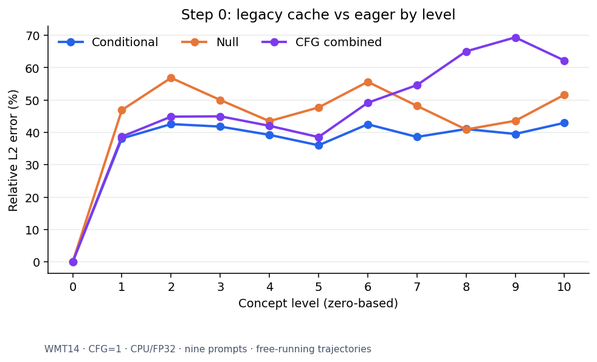
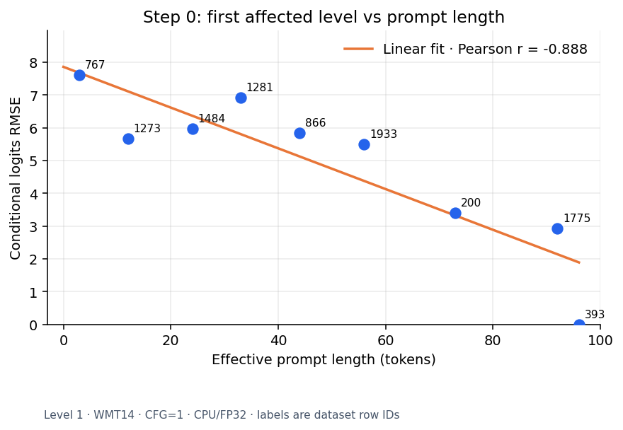
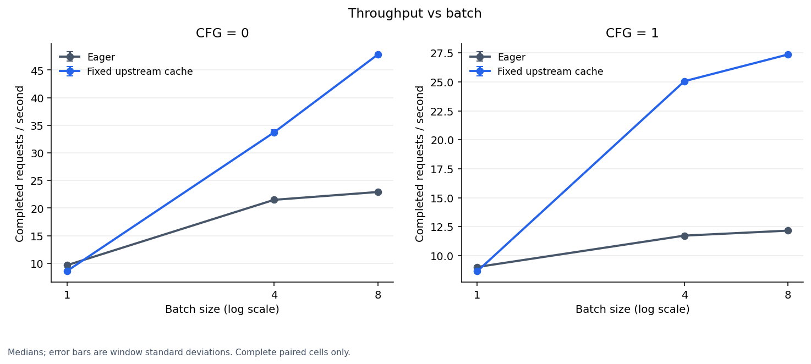
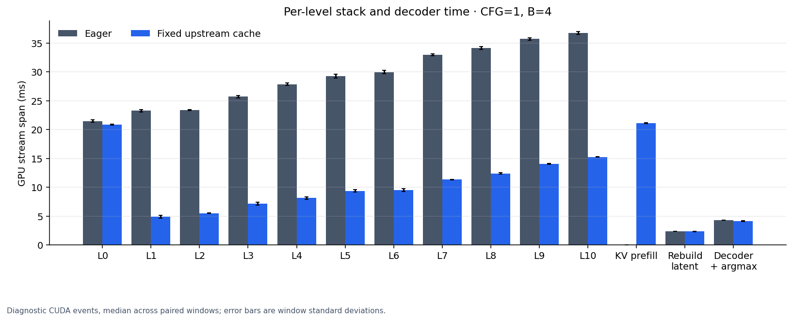
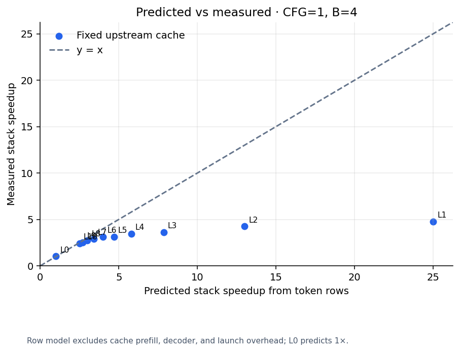
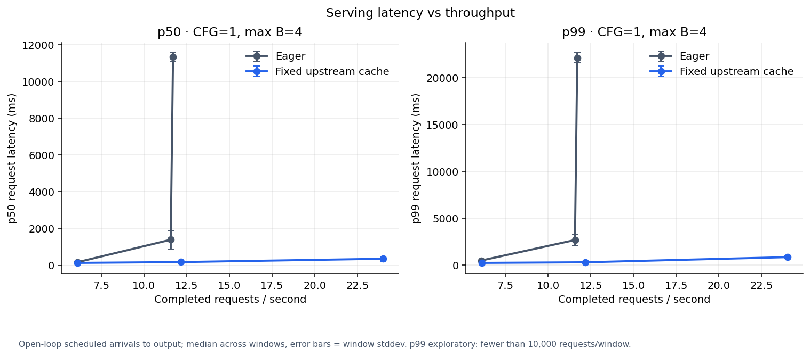
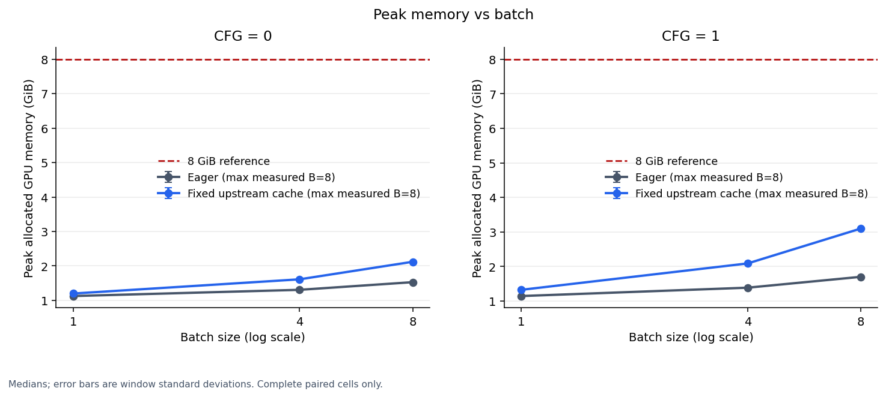

# ncminfra

Correctness and performance infrastructure for serving **Next-Concept Models (NCM)**.
Every number here was measured before anything was optimized: where does inference time go, and when do the obvious optimizations actually help?

All performance results come from one NVIDIA RTX 4060 (8 GB). The benchmark tables and figures trace back to raw records with SHA-256 provenance under [`reports/`](reports/).

## TL;DR

- **KV-cache correctness.** The upstream KV-cache path ignores prompt padding at two mask sites. With both fixed (the same fix is in open upstream [PR #5](https://github.com/HazyResearch/ncm/pull/5)), cached generation is **bitwise identical to eager on all 3003 WMT14 prompts** (CPU, FP32). On CUDA it produced **0 code/ID mismatches** across 1024 prompts × 6 configurations. An ablation shows that fixing either site alone is not enough.
- **Benchmark harness.** Covers E2E throughput, a per-level CUDA-event profile, and open-loop serving. It uses paired windows, an exact-output quality gate before every timed cell, and SHA-256 provenance for sources and assets.
- **Main finding.** On this machine, a 12-layer stack has a **~8 ms CPU-launch floor**. A stack costs the same whether it processes 4 or 160 token-rows, until it holds roughly 250 rows. Below that floor the KV cache cannot help: it is **0.89× at B=1** (an extra prefill pass adds cost and saves nothing). Above it, the cache gives **2.09–2.25× at B=8**.
- **Serving.** Open loop, CFG=1, max batch 4. Eager saturates at **~11.7 req/s**. The cache path sustains **24 req/s at p50 361 ms**.

## Background: what NCM inference does

NCM generates coarse-to-fine. One request produces 11 concept levels of lengths `[1, 4, 8, 14, 20, 26, 32, 40, 48, 56, 64]` (313 codes in total). These are reconstructed into a latent and decoded into 64 output tokens. Each level is one full, non-causal forward of a shared transformer (12 layers, 12 heads, d=768). It attends over a 96-token prompt prefix plus the current level.

| Path | Work per level |
|---|---|
| Eager | Re-encodes the prefix at every level: one stack over `96 + L` rows per sequence |
| KV cache | Encodes the prefix once, then runs only the `L` level rows against cached prefix K/V |

The cache is valid because the prefix K/V are identical at every level: the prefix cannot attend to level tokens, and prefix RoPE positions are fixed.

In what follows, **token-rows** means `sequences × stack length`, where `sequences = B × (1 + CFG)`. Classifier-free guidance (CFG=1) adds a null branch, which doubles the rows.

## 1. Correctness: the KV-cache padding mask

Upstream `models/next_concept.py` at `c702742` builds zero masks for the cached path, at the prefix prefill (L654) and at the level mask (L683). Neither mask adds the prompt padding bias `_pbias`, so cached K/V and level queries both see PAD keys. This is worst under CFG=1, where the null prefix contains 95 PAD tokens.

The fix adds `_pbias` at both sites. The same two lines are part of open upstream [PR #5](https://github.com/HazyResearch/ncm/pull/5). This repo measures the bug's impact and validates the fix.

**Ablation: are both fix sites needed?** Starting from the fixed code, each site's patch is removed in turn and compared against eager. The first three rows are deliberately broken variants. The last row is the fix this repo uses. 8 prompts with valid lengths 3–92, B=8, CFG=1; each run produces 2504 codes and 512 output IDs.

| Variant | Codes that differ | IDs that differ | Texts that differ | Matches eager? |
|---|---:|---:|---:|---|
| Upstream, no fix | 1984 | 325 | 8/8 | ✗ |
| Prefill mask fixed only | 1706 | 285 | 8/8 | ✗ |
| Level mask fixed only | 1523 | 234 | 8/8 | ✗ |
| **Both sites fixed (this repo)** | **0** | **0** | **0/8** | **✓ bitwise** |

Fixing either site alone still leaves every text wrong. CFG=0 gives the same pattern: 1857 / 1593 / 1402 / 0 differing codes.

**Full WMT14, CFG=1, CPU FP32.** For all 3003 prompts, everything matches bit for bit: per-level cond/null/guided logits, the final latent, decoder logits, all 939,939 codes, all 192,192 IDs, and the post-generation RNG state. Details: [validation report](reports/results/2026-10-28-wmt14-kv-cache-fix.md) (in Chinese).

**CUDA (RTX 4060, FP32, TF32 off).** Before timing, every benchmark cell compares codes and final IDs against eager for all 1024 selected prompts: B ∈ {1, 4, 8} × CFG ∈ {0, 1}, 0 mismatches. For reference, eager quality on the full test set is BLEU 21.72 (CFG=0) and 22.95 (CFG=1), sacreBLEU 2.5.1 ([F00 report](reports/results/F00-v1.md)).

<p align="center">
  
  
</p>

*Left: how far the unfixed cache diverges from eager at each level. Right: level-1 error against valid prompt length. Shorter prompts mean more padding and larger error (9 exploratory prompts, Pearson r = −0.888).*

## 2. Performance on an RTX 4060

**Setup.**

- GPU: GeForce RTX 4060 (24 SMs, 8 GB, 24 MB L2).
- Software: Windows 10 (WDDM), driver 560.94, PyTorch 2.6.0+cu118.
- Numerics: FP32 with TF32 off, default SDPA backends, greedy sampling (`top_k=1`).
- Workload: 1024 WMT14 prompts per cell, 5 paired windows per cell.

Raw data: [`reports/benchmark-2026-10-29/`](reports/benchmark-2026-10-29/).

### 2.1 End-to-end throughput

| Config | Eager (req/s) | Fixed cache (req/s) | Cache / eager |
|---|---:|---:|---:|
| CFG=0, B=1 | 9.65 | 8.60 | **0.89×** |
| CFG=0, B=4 | 21.50 | 33.72 | 1.59× |
| CFG=0, B=8 | 22.92 | 47.80 | 2.09× |
| CFG=1, B=1 | 9.01 | 8.65 | **0.96×** |
| CFG=1, B=4 | 11.73 | 25.06 | 2.14× |
| CFG=1, B=8 | 12.16 | 27.37 | 2.25× |

Values are medians over 5 windows. Speedups are medians of per-window paired ratios, and the ratio spread across windows is within about 2%.

<p align="center"></p>

### 2.2 Where the time goes: launch-bound vs compute-bound

<p align="center"></p>

**At small batch, stack time does not depend on rows.** At B=1 every stack takes about 8 ms, whether it processes 100–160 rows (eager) or 4–64 rows (cache). Its GPU span also matches its CPU enqueue time, which means the GPU is waiting on kernel launches.

| B=1, CFG=0 | Rows | GPU span (ms) | CPU enqueue (ms) |
|---|---:|---:|---:|
| Eager, level 1 | 100 | 8.05 | 7.86 |
| Cache, level 1 | 4 | 8.38 | 8.27 |
| Eager, level 10 | 160 | 7.82 | 7.58 |
| Cache, level 10 | 64 | 8.01 | 7.91 |

**This accounts for the B=1 slowdown.** The cache path saves rows, which costs nothing at this size, and adds two kinds of work:

- one extra prefix prefill stack, +7.8 ms;
- about 0.45 ms of extra per-level work in levels 1–10, which adds 0.4 ms to level 1 and 4.0 ms across levels 2–10.

Together that is +12.2 ms in the profile. The uninstrumented E2E batch latency gap is 12.8 ms (102.8 vs 115.6 ms).

The profile spans sum to within 1.5% of uninstrumented E2E batch latency in every cell checked (B=1 and B=8, both CFG settings), so the per-level breakdown can be trusted.

**At large batch, stacks become compute-bound.** At CFG=1, B=8, eager level 0 runs 1536 rows in 42.1 ms. The stack is about 170 MFLOP per row (matmuls only), so that is about **6.2 TFLOPS**, roughly 40% of the card's ~15 TFLOPS FP32 peak.

Weight streaming never binds in these configurations. Reading the ~340 MB of FP32 stack weights at 272 GB/s takes about 1.25 ms, far below the 8 ms launch floor.

<p align="center"></p>

**The current predictor is a FLOP ratio, and it fails where launches dominate.** `predicted_vs_measured` uses `(P+L)/L`. It predicts 25× at level 1 and measures about 4.8× (CFG=1, B=4).

A preliminary two-regime fit to all 132 stack spans gives:

`t_stack ≈ max(8.0 ms, 1.06 ms + 28 µs × rows)`

- Median absolute error: 3.1%.
- The two regimes meet at about 250 token-rows.
- The worst misses are cache levels 1–2 right after the prefill. The prefill is GPU-bound, so by the time the GPU reaches level 1 the CPU has already queued its kernels, and the event span measures pure GPU time (~4.9 ms at 32 rows). That points to a GPU-side floor at small shapes about 4× the weight-read time.

This fit is not part of the harness yet. Turning it into a proper cost model is the first item on the [roadmap](#roadmap).

### 2.3 Serving: latency vs throughput

Single worker, seeded Poisson open-loop arrivals, CFG=1, dynamic batching up to B=4, 500 requests per window, 5 windows. Latency is measured from scheduled arrival to final IDs on the CPU.

| Arrival rate (req/s) | Eager: completed/s | Eager: p50 / p99 (ms) | Cache: completed/s | Cache: p50 / p99 (ms) |
|---:|---:|---:|---:|---:|
| 6 | 6.1 | 169 / 489 | 6.1 | 137 / 238 |
| 12 | 11.6 | 1,396 / 2,682 | 12.2 | 181 / 300 |
| 24 | 11.7 | 11,316 / 22,146 | 24.0 | 361 / 851 |

Eager saturates at its E2E capacity (11.7 req/s), so its queue grows without bound at 12 and 24 req/s. The p99 values are exploratory because there are fewer than 10,000 requests per window.

<p align="center"></p>

### 2.4 Memory: an open anomaly

<p align="center"></p>

The cache path uses more memory than eager. At CFG=1, B=8, the peak working set above resident weights is **2.05 GiB for the cache vs 0.65 GiB for eager**.

The prefix K/V should only take about **108 MiB**: 96 tokens × 12 layers × (K, V) × 768 × 4 B × 16 sequences. The extra ~1.3 GiB is not explained yet.

## 3. Methodology

- **Pairing.** All systems run in one process on one loaded model. Windows alternate AB/BA in a seeded order, with 5 windows per cell.
- **Warmup.** Before each window, a system runs warmup batches until two consecutive 5-batch medians agree within 5% (10–50 batches). A system that never stabilizes is marked `UNSTABLE_WARMUP` and kept in the record.
- **Quality gate.** Before timing, codes and final IDs must match eager exactly for every selected sample. Output hashes inside timed windows are re-checked per batch.
- **E2E boundary.** Pre-tokenized padded IDs on the CPU → H2D → `generate` → latent reconstruction → decoder + argmax → D2H final IDs.
- **Profile.** CUDA events on a single stream, with no per-level synchronization, plus CPU enqueue time recorded separately. The profile runs separately from E2E, and nested spans are never summed.
- **Provenance.** `manifest.json` records source and asset SHA-256, environment, run plan and warmup rule. `run.json` stores the hashes of the raw records.

Full details (in Chinese): [`benchmarks/README.md`](benchmarks/README.md).

## 4. Reproduce

```bash
git submodule update --init upstream/ncm          # fork with the padding-mask fix
python -m pip install -r benchmarks/requirements.txt

hf download hazyresearch/ncm-checkpoints wmt14/generator.pt wmt14/tokenizer.pt wmt14/config.yaml \
  --revision 7100573f83178b6e9f45ebffe0e9aa6df384e712 --local-dir artifacts
hf download hazyresearch/ncm-datasets wmt14/sources.pickle --repo-type dataset \
  --revision 03000aa19966439de99c85a58c8e3d2f895a70ee --local-dir data
hf download Qwen/Qwen3-0.6B --revision c1899de289a04d12100db370d81485cdf75e47ca \
  --include tokenizer.json tokenizer_config.json merges.txt vocab.json \
  --local-dir artifacts/qwen3-0.6b-tokenizer

# Correctness (CPU)
python experiments/test_wmt14_kv_fix.py
python experiments/validate_wmt14_kv_fix.py --mode full --cfg 1 --batch-size 8 --output reports/raw/kv-fix-full-new

# Performance (CUDA); each output directory must not exist yet
python -m benchmarks.wmt14 --mode e2e --systems eager,cache --batches 1,4,8 --cfg 0,1 \
  --n 1024 --windows 5 --output reports/raw/bench-e2e
python -m benchmarks.wmt14 --mode profile --systems eager,cache --batches 1,4,8 --cfg 0,1 \
  --n 1024 --windows 5 --profile-batches 16 --output reports/raw/bench-profile
python -m benchmarks.wmt14 --mode serving --systems eager,cache --batches 4 --cfg 1 \
  --n 1024 --windows 5 --requests 500 --arrival-rates 6,12,24 --output reports/raw/bench-serving
python -m benchmarks.plots --out reports/figures/benchmark --e2e reports/raw/bench-e2e \
  --profile reports/raw/bench-profile --serving reports/raw/bench-serving --plot-batch 4 --plot-cfg 1
```

To add a new implementation as a third system, see the adapter interface in [`benchmarks/README.md`](benchmarks/README.md#接入第三个系统).

## 5. Caveats

- **Platform.** These numbers are from Windows with the WDDM driver model, where kernel launch overhead is higher than on Linux. The 8 ms floor is specific to this platform.
- **Scope.** FP32 only, TF32 off, greedy sampling, WMT14 only, one consumer GPU. There are no multi-GPU results.
- **CUDA exactness.** Checked on 1024 prompts per cell, not the full 3003.
- **CPU enqueue in GPU-bound cells.** Enqueue times rise to 26–46 ms in the largest eager cells. This is most likely launch-queue back-pressure, not real CPU cost, so read CPU cost from the launch-bound cells instead.
- **Git provenance.** In all four runs, `git rev-parse` exited 128 because of Git's `dubious ownership` check: the benchmark ran as a sandbox user that does not own the repository. The manifests therefore record an error for `root_git` and `upstream_git`, yet `run.json` still reports `provenance_valid: true`. The code is recoverable from the recorded source SHA-256 fingerprints. After CRLF normalization (Windows checkout), all 19 match `benchmarks/` at ncminfra `a9ceb48` (unchanged at `6fd3b17`) and `upstream/ncm` at `e441cc5`.

## Roadmap

Each item is ordered by what the measurements above point to. Each one goes through the proposal → approval → report flow in [`reports/`](reports/) before any implementation. IDs in parentheses refer to the candidate work packages in the kickoff checklist.

**R0. Housekeeping (now)**

- Add `safe.directory` for the benchmark user (root cause found: sandbox user ≠ repo owner), and treat any git provenance failure as `provenance_valid: false`.
- Normalize line endings (`.gitattributes`, or hash LF-normalized content) so source fingerprints match across Windows and Linux checkouts.
- Remove the orphan `worktrees/*` gitlinks and the tracked `.cache/` files.

**R1. Hardware-aware cost model and correlation**

- Replace `(P+L)/L` with `max(launch floor, compute term, weight-streaming term)`, with parameters derived from device specs and calibrated on the profile data.
- Plot predicted vs measured **absolute** stack time, and report an error table per regime.
- *Done when* the model and its error table are generated from raw records by `benchmarks/plots.py`.

**R2. Kernel-level breakdown with Nsight Systems**

- Measure kernel count per stack, per-kernel duration and launch gaps.
- Explain the ~8 ms CPU floor and the ~4.9 ms GPU-side floor at small shapes, and confirm or reject the back-pressure explanation for inflated enqueue times.
- *Done when* a per-stack kernel table backs each regime in R1.

**R3. Upstream PR #5 as the third system (F01)**

- PR #5 also reuses the level-0 pass's prefix K/V, which removes the separate cache prefill. That prefill costs 7.8 ms per batch at B=1 and 43 ms at CFG=1, B=8.
- Write the predicted speedup down *before* measuring, plug PR #5 in through the candidate adapter, then measure.
- Post the ablation and GPU results to the PR.

**R4. Memory anomaly**

- Use `torch.cuda.memory._record_memory_history()` snapshots to find out who owns the extra ~1.3 GiB in the cache path.
- Rule out the reference cycle reported in upstream PR #4.
- *Done when* the measured working set is explained to within 10% of a component-wise estimate.

**R5. CUDA Graphs for the launch-bound regime**

- Every shape is static: a 96-token prefix and fixed level lengths, so one graph can be captured per (B, CFG, level).
- The expected ceiling comes from R2's GPU-side floor.
- The exact-output quality gate stays unchanged.

**R6. Level-aware continuous batching (F04)**

- Batch same-level work across requests so stacks cross the ~250-row regime boundary.
- Evaluate with the open-loop harness, reporting goodput under an explicit latency SLO.

**R7. Kernels, only where R2 shows they matter (F03, F02)**

- Attention over `[prefix K/V | level K/V]` with a joint softmax instead of `torch.cat`.
- Fused norm/RoPE, and a sampling fast path.
- Each comes with D07-style shape and numerics tests.

**R8. Platform and scale (deferred)**

- Re-run on Linux (and a cloud L4) to separate WDDM effects.
- Then multi-GPU: the level-group split vs data parallelism at equal GPU count.

**Out of scope for now**

- TF32, BF16 and other precision changes. They need their own tolerance-based quality policy and would be reported separately from exact optimizations.

## Repository layout

```text
benchmarks/        harness (wmt14.py), measurement helpers (core.py), figures (plots.py)
experiments/       KV-cache probe and fix validation
reports/
  benchmark-2026-10-29/   E2E, profile, serving and smoke runs + figures
  results/                result reports (KV fix, F00, F11)
  raw/                    raw validation records and manifests
  proposals/, audits/, research/, approval-log.md
upstream/ncm       submodule: HazyResearch/ncm @ c702742 + padding-mask fix
```

## Acknowledgements

- NCM is by Hazy Research: [paper](https://arxiv.org/abs/2610.14162), [code](https://github.com/HazyResearch/ncm).
- The padding-mask fix and level-0 prefix K/V reuse also appear in [PR #5](https://github.com/HazyResearch/ncm/pull/5) by Daniel N. Lang.
- Companion repo: [NCMserving](https://github.com/somethinggoodenough/NCMserving), a concept-level serving runtime.
